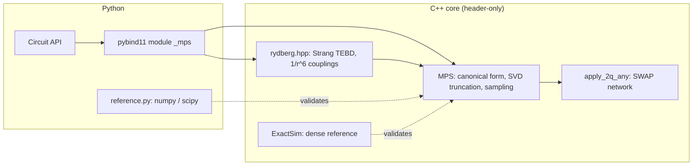
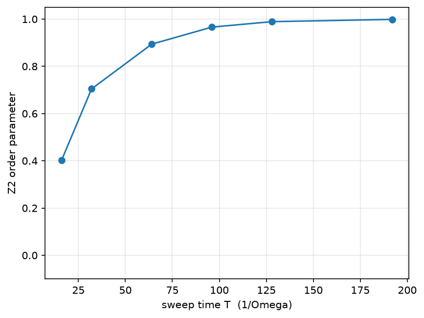
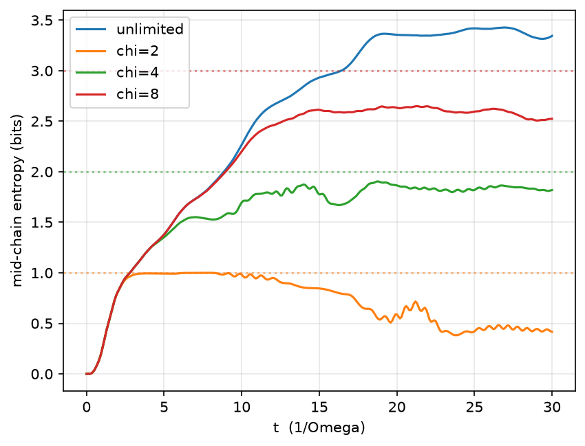
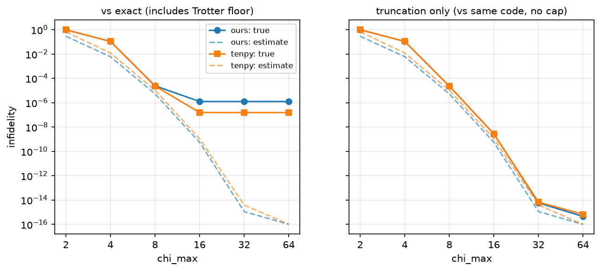
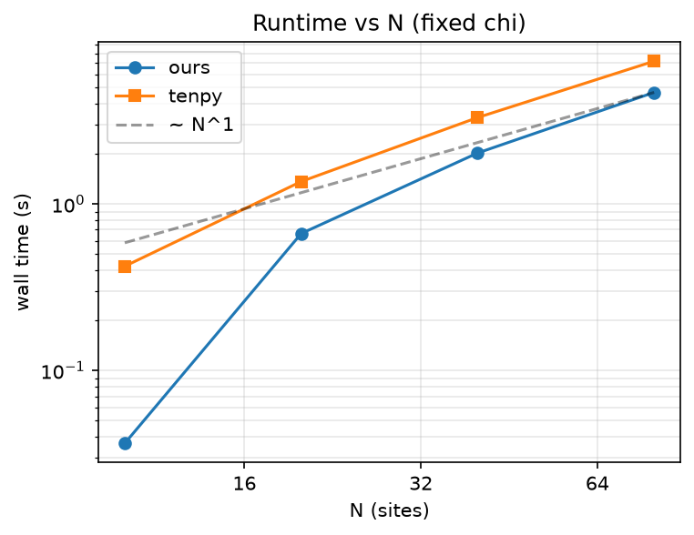
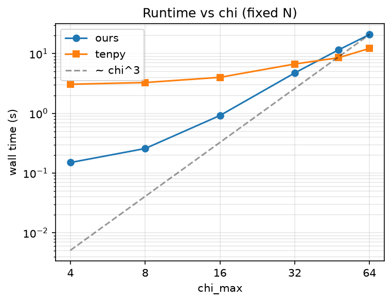

# mps: a Matrix Product State simulator for neutral-atom circuits

[](https://github.com/OWNER/REPO/actions/workflows/ci.yml)

A C++20 MPS simulator with pybind11 bindings, built for the low-entanglement regime that
neutral-atom (Rydberg) platforms run: quench dynamics, adiabatic state preparation, shallow circuits.
Every truncation is tracked, and the code is checked against an exact state-vector solver,
analytic states (GHZ, QFT) and [TeNPy](https://tenpy.readthedocs.io).

## Features

- **MPS core.** Left, right and mixed canonical form (QR gauge moves), normalization.
- **Gates.** One-qubit gates are exact. Two-qubit gates use SVD truncation with a bond cap `chi_max` and a
  relative singular-value cutoff. Any pair of qubits works: non-adjacent gates go through a SWAP network.
- **Error tracking.** Discarded weight at every truncation, running fidelity estimate `prod(1 - w)`,
  entanglement entropy per bond.
- **Readout.** Perfect sampling in `O(N chi^2)` per shot, projective measurement with collapse, densities.
- **Rydberg dynamics.** Second-order Trotter (Strang) for
  `H(t) = sum_i Omega_i(t)/2 X_i - Delta_i(t) n_i + sum_{i<j, |i-j|<=R} V_nn/|i-j|^6 n_i n_j`
  with time-dependent drive and a long-range cutoff `R`.
- **References.** Dense `ExactSim` (N <= 20) and numpy/scipy references (dense, sparse, Krylov).
- **Python.** `import mps`: a `Circuit` builder, the `MPS` object, `evolve_rydberg`.

## Build

```bash
cmake -S . -B build && cmake --build build && ctest --test-dir build --output-on-failure   # C++ tests, ASan + UBSan
uv sync                                                                                   # Python environment
cmake -S . -B build-rel -DCMAKE_BUILD_TYPE=Release -DPython_EXECUTABLE=$PWD/.venv/bin/python
cmake --build build-rel --target _mps                                                     # Python extension
uv run pytest -q
```

## Use

```python
import mps
from mps import Circuit

c = Circuit(8).h(0)
for i in range(7):
    c.cnot(i, i + 1)                    # GHZ
psi = c.run(chi_max=4)
print(psi.bond_dims(), psi.entropies())  # every bond 2, every entropy 1 bit
print(psi.sample(5))                     # (5, 8) array of 0/1
```

Adiabatic Z2 preparation in an 11-atom chain (about 30 s):

```python
import numpy as np
import mps

N, T, V = 11, 64.0, 10.0

def omega(i, t):                          # sin^2 ramps on and off, flat in between
    tr = 0.1 * T
    s = np.sin(0.5 * np.pi * t / tr) if t < tr else np.sin(0.5 * np.pi * (T - t) / tr) if t > T - tr else 1.0
    return s * s

psi = mps.MPS(N)
mps.evolve_rydberg(psi, V_nn=V, R=3, omega=omega, delta=lambda i, t: -3 + 6 * t / T,
                   t0=0.0, T=T, steps=int(T / 0.02), chi_max=64)
print(mps.z2_order(psi.densities()))      # 0.894
```

Units: `Omega_max = 1`, time in `1/Omega`. State `|1>` is the Rydberg state, `n = |1><1|`.
Qubit 0 is the most significant bit in every state vector.

## Architecture



One two-qubit gate on sites `(i, i+1)`:

```
move center to i  ->  theta = A_i . A_{i+1}  ->  apply 4x4 gate  ->  reshape to (l,a) x (b,r)
  ->  SVD  ->  keep k = min(chi_max, s_k/s_0 > cutoff)  ->  w = discarded s^2 / total
  ->  A_i = U (left isometry),  A_{i+1} = S V^H (rescaled to keep the norm)
```

With the center at `i`, both environments are orthonormal. That makes the truncation optimal and
`w` exact for the cut.

## Validation

| Check | Against |
|---|---|
| 1q and 2q gates, random circuits, any qubit pair (SWAP network) | dense state vector |
| Canonical form, norm, isometry conditions | analytic invariants |
| Single-truncation fidelity estimate | true overlap with exact state |
| GHZ amplitudes and entropy, QFT of basis states | analytic formulas |
| Sampling, `prob1`, measurement collapse | Born probabilities, GHZ correlations |
| Rydberg Trotter (static and swept, with and without long range) | `expm` from the Hamiltonian definition, second-order scaling |
| Python API | independent numpy implementation |
| Fidelity, entropy, observables, truncation error | TeNPy TEBD (`bench/compare_tenpy.py`) |

## Results

### Fidelity vs bond dimension (random brickwork circuit, N=14, 16 layers)

| chi | 1 | 2 | 4 | 8 | 16 | 32 | 64 |
|---|---|---|---|---|---|---|---|
| true fidelity | 9e-5 | 0.059 | 0.43 | 0.833 | 0.9936 | 0.99997 | 1 |
| estimate | 6e-7 | 0.065 | 0.44 | 0.836 | 0.9934 | 0.99996 | 1 |

The estimate tracks the truth within about 1% once F > 0.8. Exact at chi = 64, below the maximum bond 128.

### Adiabatic Z2 preparation (N=11, R=3, V_nn = 10, Delta: -3 -> +3)

| sweep time T (1/Omega) | 16 | 32 | 64 | 96 | 128 | 192 |
|---|---|---|---|---|---|---|
| Z2 order parameter | 0.402 | 0.704 | 0.894 | 0.966 | 0.989 | 0.9987 |



- Long-range cutoff: R=4 changes the order parameter by at most 6.6e-4 relative to R=3. R=1 is not adequate:
  it differs by up to 0.14 (T=8).
- Trotter step: `dt = 0.02` vs `0.01` differs by at most 4e-5.
- With TeNPy at T=32, `dt=0.05` (R=1): exact 0.6372, this code 0.6371, TeNPy 0.6367.

### Entanglement growth after a quench (N=12, from |0...0>, Omega=1, Delta=0, V=10)

The unlimited run saturates at about 3.4 bits. Capped runs stop following it once the cap binds:

| chi (cap) | max entropy | estimated F < 0.99 at | estimated F < 0.9 at |
|---|---|---|---|
| 2 (1 bit) | 1.00 | t = 3.7 | t = 5.4 |
| 4 (2 bits) | 1.90 | t = 7.7 | t = 13.1 |
| 8 (3 bits) | 2.65 | t = 12.7 | t = 27.2 |



### Comparison with TeNPy (nearest-neighbor quench, N=14, T=6, dt=0.025)

Same Hamiltonian, same step size, same number of second-order Trotter steps.

| chi | truncation error, this code | truncation error, TeNPy |
|---|---|---|
| 4 | 0.108 | 0.108 |
| 8 | 2.30e-5 | 2.29e-5 |
| 16 | 2.67e-9 | 2.65e-9 |

Truncation errors agree to three digits. Against the exact (Krylov) state the untruncated runs differ only by Trotter
error: 1.2e-6 here, 1.5e-7 for TeNPy. The two codes split the Hamiltonian differently (drive vs interaction here,
even vs odd bonds in TeNPy), so the error constants differ.



### Performance

Single thread for every BLAS/LAPACK pool; Release build; same problem on both sides.

 

| | this code | TeNPy |
|---|---|---|
| N=80, chi=32, T=4 (s) | TBD | TBD |
| N=30, chi=64, T=10 (s) | TBD | TBD |

## Design notes

- **Truncation.** Singular values are kept while `s_k / s_0 > cutoff` and `k < chi_max`. The discarded weight is
  `sum(dropped s^2) / sum(all s^2)`. The kept values are rescaled so the norm is unchanged.
- **Error estimate.** `prod(1 - w)` is exact for a single truncation in canonical form. Over a long evolution it is
  optimistic: errors from thousands of small truncations add coherently. For the quench above it underestimates the true
  infidelity by 4 to 18 times (chi=4: 6.0e-3 estimated, 0.108 true). For random circuits it matches. TeNPy's estimate
  behaves the same way. Treat it as a diagnostic, and measure convergence in chi when it matters.
- **Long-range interactions.** Terms `n_i n_j` with `|i-j| = d > 1` use a SWAP network: `2(d-1)+1` two-site gates
  per term, each an SVD, with truncation error added at every SWAP. Fine for cutoffs of R <= 3 to 4. An MPO or TDVP
  approach would scale better for large R; it is not implemented.
- **Second-order Trotter.** Drive terms commute with each other and so do all interaction terms, so each half-step
  is an exact product of gates. The only splitting error is between the two groups.

## Not implemented

2D-to-1D atom mapping (snake vs row-major), noise trajectories, TDVP, MPO-based long-range evolution,
multithreading. SVD uses Eigen's `BDCSVD`, not LAPACK.

## Layout

```
src/        gates.hpp  mps.hpp  rydberg.hpp  exact.hpp  brickwork.hpp  bindings.cpp
tests/      C++ (GoogleTest) and tests/python (pytest)
bench/      convergence, z2_sweep, quench_entropy, compare_tenpy.py, bench_scaling.py
python/mps/ Python package: Circuit, gates, reference
scripts/    plotting
```
